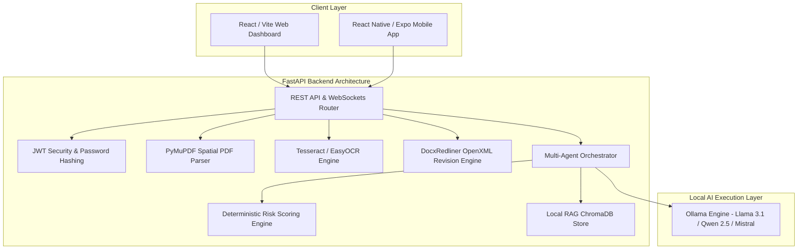

# LegalFlow AI 🛡️⚖️

> **Private Multilingual AI Legal Document Assistant, Contract Risk Analyzer, Redliner & Drafting Platform**

LegalFlow AI is a production-style, local-first legal AI platform built as an air-gapped solution for analyzing contracts, detecting high-risk clauses, generating native Microsoft Word OpenXML counter-proposals with Track Changes, visual spatial PDF bounding box mapping, and delivering explanations in English, Hindi, Marathi, Tamil, Spanish, and French.

---

## 📌 Problem Statement

Legal contracts, non-disclosure agreements, leases, and employment contracts are often packed with complex legalese, hidden penalties, and one-sided liabilities. Traditional legal review is expensive and slow. Existing commercial AI legal solutions (e.g. cloud SaaS platforms) require uploading confidential legal documents to third-party cloud APIs (OpenAI, Anthropic, Gemini), exposing users to data privacy violations, corporate espionage, and regulatory non-compliance.

## 🎯 Objectives

1. **100% Privacy & Offline Execution**: Ensure all document text, OCR extraction, vector search, and AI inference execute locally on the user's machine without external cloud API dependencies.
2. **Deterministic Risk Scoring**: Prevent non-deterministic AI score hallucinations by calculating contract safety (0–100) using a mathematical risk engine based on weighted clause severity.
3. **Spatial PDF Risk Overlay**: Extract word-level coordinates (`xmin, ymin, xmax, ymax`) to render interactive, color-coded bounding boxes over risky clauses on a canvas.
4. **Native OpenXML Redlining**: Edit `.docx` files by directly injecting WordprocessingML `<w:del>` and `<w:ins>` revision tags for Microsoft Word Track Changes compatibility.
5. **Multilingual Legalese Simplification**: Translate complex legal jargon into simple, plain-language explanations in English, Hindi, Marathi, Tamil, Spanish, and French.

---

## 🏗️ System Architecture



---

## 📸 Key Features

- **🔒 100% Local-First & Air-Gapped**: Powered by **Ollama** (`llama3.1:8b`, `qwen2.5:7b`) with embeddings saved in local **ChromaDB**. Zero cloud uploads.
- **📝 OpenXML Track Changes Redlining**: Generates native `.docx` files containing real Microsoft Word `<w:del>` and `<w:ins>` revision tags.
- **🎯 Spatial PDF Bounding Box Canvas**: Maps word-level coordinates (`xmin, ymin, xmax, ymax`) via PyMuPDF to render visual red highlight overlays on contract PDFs.
- **📊 Mathematical Safety Scoring**: Deterministic 0–100 safety score formula based on weighted clause risk severity (Liability, Discretion, Forfeiture, Renewal).
- **🗣️ Multilingual Explanations**: Parallel explanations available in **English**, **Hindi (हिन्दी)**, **Marathi (मराठी)**, **Tamil (தமிழ்)**, **Spanish (Español)**, and **French (Français)**.
- **💬 Real-Time Streaming Chatbot**: WebSocket (`/ws/chat`) streaming assistant for document-grounded legal Q&A.
- **📄 Form-Driven Contract Drafting**: Generates customizable NDAs, Residential Leases, Freelance Agreements, Employment Contracts, and Service Agreements in `.docx` format.
- **🔀 Side-by-Side Comparison**: Computes category-level structural diffs between document versions.
- **📱 Mobile Scanner**: React Native Expo app layout with `expo-camera` for mobile contract capture over local Wi-Fi.

---

## 📁 Monorepo Structure

```text
legalflow-ai/
├── .github/workflows/         # CI GitHub Actions (pytest + docker build)
│   ├── ci.yml
│   └── docker-build.yml
├── backend/                   # FastAPI 0.110 Backend
│   ├── app/
│   │   ├── api/               # REST API & WebSocket Routers
│   │   │   ├── routes.py
│   │   │   └── websocket.py
│   │   ├── core/              # Security, Database & Config
│   │   │   ├── config.py
│   │   │   └── database.py
│   │   ├── models/            # SQLAlchemy ORM & Pydantic Schemas
│   │   │   ├── db_models.py
│   │   │   └── schemas.py
│   │   ├── services/          # Core Legal Engines
   │   │   ├── docx_redliner.py    # OpenXML Track Changes Engine
   │   │   ├── pdf_parser.py       # Spatial PDF Coordinate Parser
   │   │   ├── risk_engine.py      # Deterministic 0-100 Score Engine
   │   │   ├── agent_engine.py     # Multi-Agent Orchestrator
   │   │   ├── vector_store.py     # ChromaDB RAG Vector Store
   │   │   ├── template_service.py # Contract Generator Engine
   │   │   ├── document_service.py # Comparison & Timeline Extractor
   │   │   └── ocr_service.py      # Tesseract OCR Service
│   │   └── main.py            # FastAPI Main App & Static Mount
│   └── tests/                 # Comprehensive Automated Pytest Suite
│       ├── test_backend.py
│       ├── test_docx_redliner_openxml.py
│       └── test_e2e_full.py
├── web/                       # React 18 + Vite + Tailwind Web Application
│   ├── src/
│   │   ├── components/        # PdfViewer, RiskScoreGauge, RiskCard, ChatDrawer
│   │   ├── pages/             # Dashboard, Workspace, Upload, Compare, Templates
│   │   └── services/          # Axios API Client
│   ├── index.html
│   └── vite.config.js
├── mobile/                    # React Native Expo Mobile Scanner Shell
│   ├── src/
│   │   ├── components/        # CameraScanner, MultilingualCard
│   │   └── screens/           # ScanScreen, RiskSummaryScreen, ChatScreen
│   ├── App.js
│   └── package.json
├── knowledge/                 # Local Legal Knowledge Base & RAG Corpora
├── storage/                   # Local SQLite DB & File Store
├── docker-compose.yml         # Container Orchestration
├── LITERATURE_SURVEY.md       # Academic Literature Survey & Comparative Analysis
└── README.md                  # Complete Documentation
```

---

## 🛠️ Installation & Setup Guide

### 1. Prerequisites
- Python 3.11+
- Node.js 18+
- Ollama (installed locally from [ollama.com](https://ollama.com))
- Tesseract OCR (installed locally for scanned PDF processing)

### 2. Ollama & Model Setup
```bash
# Start Ollama service
ollama serve

# Pull required local LLM and embedding models
ollama pull llama3.1:8b
ollama pull nomic-embed-text
```

### 3. Backend Setup
```powershell
cd backend
python -m venv venv
.\venv\Scripts\Activate.ps1
pip install -r requirements.txt
uvicorn app.main:app --host 127.0.0.1 --port 8000 --reload
```

### 4. Frontend Web Setup
```powershell
cd web
npm install
npm run dev
```
Open `http://localhost:3000` in your web browser.

### 5. Mobile App Setup
```powershell
cd mobile
npm install
npx expo start
```

---

## 🐳 Docker Deployment

To build and run LegalFlow AI using Docker Compose:

```bash
docker-compose build
docker-compose up -d
```

Service ports:
- **Web Interface**: `http://localhost:3000`
- **FastAPI Backend**: `http://localhost:8000`
- **ChromaDB**: Port `8001`

---

## 🧪 Testing & Verification

Run the full automated verification test suite:

```powershell
$env:PYTHONPATH="backend"
python -m pytest backend/tests -v
```

Verification includes:
- Authentication & JWT verification
- PyMuPDF spatial coordinate normalization
- OCR fallback handling
- OpenXML `<w:del>` and `<w:ins>` revision tags validation
- Deterministic 0-100 risk scoring
- Local Ollama status & structured JSON parsing
- Full end-to-end legal document workflow

---

## 🔒 Security & Privacy Architecture

- **Air-Gapped Data Guarantee**: All document parsing, vector indexing, and AI generation take place on the host machine.
- **File Upload Safeguards**: MIME type verification, UUID file rename sanitization, file size limits (configurable up to 20MB), and path traversal prevention.
- **Authentication**: Salted bcrypt password hashing with short-lived JWT access tokens.
- **RBAC**: Multi-tenant database schema ensuring users only access their own documents.

---

## ⚠️ Limitations & Future Scope

### Current Limitations
- Complex scanned multi-column tables may require manual review.
- Advanced font styles in custom Word templates are simplified during OpenXML redline insertion.

### Future Scope
- Integration with local fine-tuned legal models (e.g. Legal-Llama).
- Multimodal contract image parsing directly via Qwen-VL local models.
- Support for automated e-signature verification.

---

## ⚖️ Legal Disclaimer

> **IMPORTANT**: LegalFlow AI provides informational document analysis and does not constitute legal advice, legal representation, or a substitute for a qualified legal professional.
